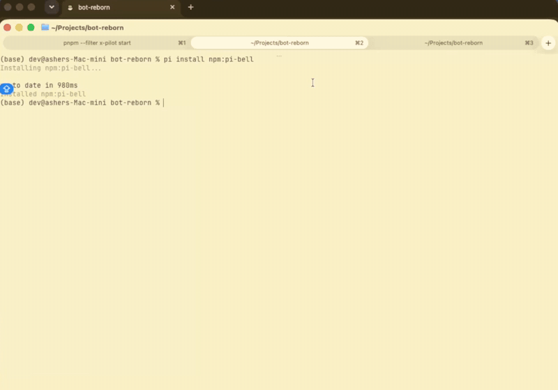

# pi-bell

Desktop notifications for [Pi](https://www.npmjs.com/package/@earendil-works/pi-coding-agent) agent runs: when a run **finishes**, when you **abort** it, and when it **fails**.

It fires once the run has really settled — after retries, compaction retries, and queued follow-ups — and covers terminals that have no OSC support.



The same clip as a video: [demo.mp4](demo.mp4). Regenerate either one with `./scripts/make-demo.sh <recording.mp4>`.

```
Pi ✓   done · 42s · my-project
Pi ⚠   aborted · 5s · my-project
Pi ✕   failed · 4s · my-project — 401 unauthorized
```

## Install

```bash
pi install npm:pi-bell
# or from git
pi install git:github.com/beasaltfish/pi-bell
# or try it for one run without installing
pi -e .
```

Restart Pi afterwards.

## How it decides

Two things matter: whether Pi and you are on the same machine, and whether a terminal multiplexer sits in between.

| Environment | Channel |
|---|---|
| local, no multiplexer, known terminal | **OSC** escape sequence, the terminal shows it |
| local, no multiplexer, unknown terminal | **system** notification (`osascript`, `notify-send`, Windows toast) |
| local tmux / screen | **system** notification — bypasses the multiplexer entirely |
| SSH, no multiplexer | **OSC** — a system notification would fire on the remote host |
| SSH + tmux | **OSC** wrapped in a DCS passthrough |

## Compatibility

| Terminal | Channel | Notes |
|---|---|---|
| Warp | OSC 777 | needs notifications enabled in Warp's settings |
| iTerm2 | OSC 777 | |
| Ghostty | OSC 777 | |
| WezTerm | OSC 777 | |
| kitty | OSC 99 | |
| rxvt-unicode | OSC 777 | |
| VS Code integrated | OSC 777 | unverified — if nothing appears, set `PI_BELL_CHANNEL=system` |
| Apple Terminal | system | OS shows it as coming from "Script Editor" |
| Alacritty | system | |
| Zed, IntelliJ, GNOME Terminal, Konsole, foot, Windows Terminal | system | |
| tmux / screen (local) | system | no tmux config needed |
| tmux (over SSH) | OSC + DCS | requires `set -g allow-passthrough on` in tmux |

`Zed` and other terminals not in the OSC list automatically fall back to system notifications.

## Environment variables

| Variable | Values | Meaning |
|---|---|---|
| `PI_BELL_CHANNEL` | `osc` \| `system` \| `off` | Skip detection and force a channel |
| `PI_BELL_TMUX_PASSTHROUGH` | `1` \| `0` | `1`: send OSC through a local tmux (requires `allow-passthrough`). `0`: never wrap, always prefer system |
| `PI_BELL_SOUND_CMD` | any shell command | Run in the background whenever a notification is sent |

```bash
# macOS
export PI_BELL_SOUND_CMD='afplay ~/Library/Sounds/Glass.aiff'
# Linux
export PI_BELL_SOUND_CMD='paplay /usr/share/sounds/freedesktop/stereo/complete.oga'
```

## Known limitations

- **Remote tmux needs configuration.** The DCS passthrough above only works with `set -g allow-passthrough on`. Local tmux does not need it.
- **An error before any assistant message is reported as success.** If the run dies before the model ever replies (bad API key, DNS failure), there is no `stopReason` to read, so it is reported as done. The `error` state requires at least one assistant message with `stopReason: "error"`.
- **macOS shows the sender as "Script Editor".** `osascript` is the app delivering the notification, and the first one prompts for permission.
- **OSC is fire-and-forget.** The terminal gives no acknowledgement, so a terminal that silently drops OSC 777 cannot be detected. If nothing shows up, set `PI_BELL_CHANNEL=system`.
- Not sent outside TUI mode: in `--print` and `--json` the caller reads the result, and in RPC mode stdout is a JSON stream that an OSC sequence would corrupt.

## Development

```bash
npm install
npm test      # node --test, no test framework dependency
npm run check # tsc --noEmit
pi -e .       # load the extension from this checkout
```

## Author

Asten — [@0xasten](https://x.com/0xasten)

## License

MIT
